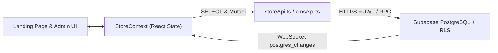

# Alfaratha Store — E-Catalog, POS Kasir, Inventori & CMS Terintegrasi Supabase

Aplikasi web terpadu untuk toko kurma dan oleh-oleh Haji/Umroh **Alfaratha Store**. Menggabungkan **Landing Page / Katalog Publik** dengan **Workspace Internal Staff (POS Kasir, Manajemen Stok & Mutasi, Riwayat Transaksi, dan CMS Konten Etalase)** dalam satu aplikasi React + TypeScript yang terhubung *realtime* ke PostgreSQL **Supabase**.

---

## Ringkasan Fitur Utama

### 1. Etalase Publik (`/`)
- **Katalog Produk Multi-Varian & Pencarian Instan:** Filter kategori, pemilih kemasan per produk (`product_variants`), info stok realtime, dan tombol order langsung ke **WhatsApp** dengan format pesan otomatis.
- **Paket Oleh-Oleh Haji & Umroh:** Toggle perbandingan harga satuan vs grosir jamaah (≥ 20 box) dengan batas aman maksimal **3 kartu aktif** agar grid 3 kolom selalu sejajar.
- **Konten Dinamis Berbasis CMS:** Seluruh teks Hero, 4 Metrik Kepercayaan, 4 Bento Keunggulan, 3 Langkah Pemesanan, 2 Testimoni teratas, 4 FAQ teratas, CTA + Peta Google Maps interaktif, hingga nomor WhatsApp tujuan ditarik langsung dari Supabase.

### 2. Workspace Admin & Kasir (`/admin/*`, diproteksi Login Staff)
- **Kasir / POS Terminal (`/admin/pos`):** Keranjang transaksi cepat, mode harga **Eceran** vs **Paket Jamaah** (diskon otomatis **15%** atau **20%** untuk total ≥ 20 unit), metode bayar `Cash / QRIS / Transfer / EDC`, shortcut keyboard `F2` untuk fokus pencarian, serta cetak/kirim struk digital WhatsApp.
- **Stok & Inventori (`/admin/inventory`):** Tambah/edit/hapus produk & varian SKU, filter lokasi simpan (`Ruang Pendingin`, `Gudang Kering`, `Gudang Palet`, `Etalase Toko`), peringatan stok minimum, dan penyesuaian stok (`restock`, `rusak`, `retur`, `koreksi`) lengkap dengan audit log mutasi.
- **Riwayat Transaksi (`/admin/transactions`):** Pencarian faktur (`TRX-YYYY-XXXX`), filter periode & metode bayar, serta pratinjau ulang struk transaksi.
- **Konten Etalase CMS (`/admin/cms`):** 6 tab manajemen konten publik (*Paket Oleh-Oleh*, *Testimoni*, *FAQ*, *Hero & Keunggulan*, *Alur & Header*, *Toko & Kontak*) dengan validasi panjang teks & slot tampil agar perubahan aman tanpa merusak layout.
- **Profil Staff (`/admin/profile`):** Pembaruan nama tampilan dan cabang petugas yang login.

---

## Tech Stack

| Layer | Teknologi | Keterangan |
| :--- | :--- | :--- |
| **Frontend** | React `^19.0.0`, TypeScript `^5.7.3` | Strict typing di `src/types/index.ts` |
| **Bundler** | Vite `^6.2.0` | Route lazy-loading, chunk splitting, inline CSS build |
| **Routing** | React Router DOM `^7.18.7` | Public routes (`/`, `/login`) & guarded routes (`/admin/*`) |
| **Styling & UI** | Tailwind CSS `^3.4.17`, Lucide React, Framer Motion | Desain responsif Mobile-first (`375px`, `768px`, `1440px`) |
| **Backend & DB** | Supabase (`@supabase/supabase-js` `2.119.2`) | PostgreSQL, PostgREST API, Auth, RLS, PL/pgSQL RPC, Realtime |

---

## Cara Kerja Sistem (Arsitektur Inti)



### 1. Manajemen State & Fetch Data (Tanpa Cache Basi di `localStorage`)
- **Penyimpanan Data:** Seluruh data produk, paket, testimoni, FAQ, dan konfigurasi etalase disimpan di **React Context State (`StoreContext`)** — **tidak di-cache di `localStorage`**. Satu-satunya yang tersimpan di `localStorage` adalah token sesi login Supabase Auth (`persistSession: true` di `src/lib/supabase.ts`) agar staff tetap login saat reload.
- **Initial Load:** Saat aplikasi dibuka, UI langsung menampilkan data fallback bawaan (`buildOptimisticProducts` & `cmsDefaults.ts`) sesaat agar tidak kosong, sambil memanggil API Supabase secara paralel (`refreshProducts()` dan `refreshCmsContent()`). Begitu respons `200 OK` tiba, state langsung diganti dengan data database.
- *Catatan Development Mode:* Di `vite dev`, `<React.StrictMode>` di `src/main.tsx` memanggil `useEffect` inisialisasi 2 kali; pada build produksi hanya berjalan 1 kali. Data sensitif (`transactions`, `stock_logs`) hanya di-fetch jika ada sesi staff yang valid.

### 2. Sinkronisasi Realtime (Update Admin maupun Edit Langsung di DB)
- `StoreContext` membuka koneksi WebSocket ke channel `alfaratha-realtime-sync` (`postgres_changes`) yang memantau seluruh tabel inti pada publikasi `supabase_realtime`.
- **Saat update lewat Admin:** Mutasi dikirim ke Supabase → `StoreContext` langsung memanggil ulang `refreshCmsContent()` / `refreshProducts()` → tab atau perangkat lain yang terbuka ikut menerima sinyal WebSocket (debounce `250 ms`) dan memperbarui tampilannya otomatis tanpa refresh manual.
- **Saat update langsung lewat Table Editor / SQL Supabase:** PostgreSQL tetap memancarkan event `postgres_changes` ke browser yang sedang aktif sehingga tampilan langsung tersinkronisasi.

### 3. Keamanan (Supabase Auth & Row Level Security)
- Staff login menggunakan email atau username (username otomatis dipetakan ke `@alfaratha.store` oleh `resolveStaffEmail()`) melalui `supabase.auth.signInWithPassword`.
- Seluruh 10 tabel mengaktifkan **RLS (`ENABLE ROW LEVEL SECURITY`)** dengan fungsi helper `private.is_staff()` (`SECURITY DEFINER`) yang mengecek keberadaan `auth.uid()` di `staff_profiles`:
  - **Publik (`anon`):** Hanya diberi hak `SELECT` pada katalog dan konten etalase (`products`, `product_variants`, `package_bundles`, `testimonials`, `faqs`, `site_contents`).
  - **Staff Terautentikasi:** Dapat menulis data sesuai kebijakan tabel; `transactions`, `transaction_items`, `stock_logs`, dan `staff_profiles` tertutup total bagi pengunjung anonim.

### 4. Transaksi & Stok Atomik via PostgreSQL RPC
Operasi kritis tidak hanya mengandalkan mutasi terpisah di client, melainkan dieksekusi di sisi database menggunakan fungsi PL/pgSQL (`SECURITY INVOKER`):
- `process_pos_checkout`: Mengunci baris varian dengan `FOR UPDATE OF pv` (urutan deterministik mencegah deadlock), memvalidasi kecukupan stok, menghitung subtotal + diskon mode `jamaah` di server, membuat nomor faktur berurutan (`TRX-YYYY-XXXX` dari sequence `pos_invoice_seq`), mengurangi stok, serta mencatat `transaction_items` dan `stock_logs` dalam **satu transaksi atomik**.
- `adjust_variant_stock`: Mengunci varian, memvalidasi stok akhir tidak negatif, memperbarui `stock`, dan menulis riwayat ke `stock_logs`.
- `create_product_with_variant`: Membuat entri `products`, `product_variants`, serta log restock awal secara atomik.

### 5. Optimasi Build Produksi (`vite.config.ts`)
- **Code Splitting & Lazy Loading:** Halaman admin (`/login`, `/admin/*`) di-*lazy load* via `React.lazy()` di `src/App.tsx`, dan section bawah di `LandingPage.tsx` dimuat bertahap agar bundle awal etalase tetap ringan.
- **Manual Chunks & Inline CSS:** Vendor `react`/`react-dom` dipisah ke `vendor-react`, ikon ke `vendor-icons`, dan plugin `inlineCssPlugin()` menyematkan CSS build langsung ke `<head>` pada HTML untuk memangkas *render-blocking request*.

---

## Rute & Skema Database

### Rute Aplikasi (`src/App.tsx`)
| Path | Akses | Halaman |
| :--- | :--- | :--- |
| `/` | Publik | Landing Page & Katalog Produk |
| `/login` | Publik | Portal Login Staff |
| `/admin/pos` | Staff | Terminal Kasir POS |
| `/admin/inventory` | Staff | Manajemen Stok & Varian SKU |
| `/admin/transactions` | Staff | Riwayat Transaksi & Struk |
| `/admin/cms` | Staff | CMS Konten Etalase Publik |
| `/admin/profile` | Staff | Profil Akun Staff |

### Tabel Database (`supabase/migrations/`)
| Tabel | File Migrasi | Fungsi |
| :--- | :--- | :--- |
| `products`, `product_variants` | `20261126000001_initial_schema.sql` | Data produk induk dan detail SKU/harga/stok/lokasi |
| `staff_profiles` | `20261126000001_initial_schema.sql` | Profil petugas kasir/gudang terhubung `auth.users` |
| `transactions`, `transaction_items` | `20261126000001_initial_schema.sql` | Header faktur dan snapshot item saat checkout |
| `stock_logs` | `20261126000001_initial_schema.sql` | Jejak audit setiap perubahan stok |
| `package_bundles`, `testimonials`, `faqs`, `site_contents` | `20261127000001_cms_tables.sql` | Data dinamis seluruh section Landing Page dari CMS |

---

## Struktur Direktori

```text
alfaratha/
├── src/
│   ├── components/
│   │   ├── auth/        # ProtectedRoute untuk proteksi rute admin
│   │   ├── cms/         # Modal & editor form Konten Etalase (/admin/cms)
│   │   ├── layout/      # Navbar, Footer, AdminLayout sidebar
│   │   ├── pos/         # Modal produk, penyesuaian stok, mutasi & struk
│   │   ├── sections/    # Section Landing Page (Hero, Katalog, Paket, FAQ, dll.)
│   │   └── ui/          # Komponen umum (ConfirmModal, TablePagination, FloatingActions)
│   ├── context/         # StoreContext (state global, auth, Supabase fetch & realtime)
│   ├── data/            # Fallback defaults (cmsDefaults.ts & data awal)
│   ├── lib/             # Inisialisasi client Supabase (supabase.ts)
│   ├── pages/           # LandingPage, LoginPage, & pages/admin/*
│   ├── services/        # Query & mutasi database (storeApi.ts, cmsApi.ts)
│   ├── types/           # Kontrak interface TypeScript terpusat
│   └── utils/           # Generator link WhatsApp & formatter IDR
└── supabase/
    ├── migrations/      # Skema DDL, RLS policies, PL/pgSQL RPC, & publikasi realtime
    └── seed.sql         # Data awal 26 produk induk & 53 varian SKU
```

---

## Setup & Menjalankan Secara Lokal

### 1. Instalasi & Konfigurasi Environment
```bash
npm install
cp .env.example .env   # Windows PowerShell: Copy-Item .env.example .env
```
Isi `.env` dengan kredensial proyek Supabase Anda:
```env
VITE_SUPABASE_URL=https://your-project-ref.supabase.co
VITE_SUPABASE_PUBLISHABLE_KEY=sb_publishable_your_key_here
```

### 2. Setup Database Supabase
Jalankan file SQL berikut secara berurutan di **Supabase SQL Editor** pada proyek Anda:
1. `supabase/migrations/20261126000001_initial_schema.sql` — tabel katalog, POS, stok, RLS, RPC, & realtime.
2. `supabase/migrations/20261127000001_cms_tables.sql` — tabel CMS etalase, RLS, & realtime.
3. `supabase/seed.sql` — mengisi data awal 26 produk dan 53 varian SKU *(bagian teks `site_contents` otomatis fallback per-section ke `src/data/cmsDefaults.ts` jika baris belum ada; paket, testimoni, dan FAQ dapat ditambah langsung melalui `/admin/cms`)* .
4. Buat akun user di **Authentication → Users** lalu daftarkan UUID-nya ke tabel `public.staff_profiles` agar akun memiliki izin akses staff (`private.is_staff()`).

### 3. Script Perintah
| Perintah | Fungsi |
| :--- | :--- |
| `npm run dev` | Menjalankan server development Vite (`http://localhost:5173`) |
| `npm run build` | Type-check TypeScript (`tsc -b`) dan build produksi ke `dist/` |
| `npm run preview` | Pratinjau lokal hasil build produksi di port `5173` |

### Akun Demo (Lingkungan Development / Portofolio)
Pada halaman `/login` tersedia tombol **"Isi Akun Demo"** untuk pengujian cepat:
- **Email / Username:** `kasir@alfaratha.store` (atau ketik `kasir`)
- **Password:** `alfaratha2025`
